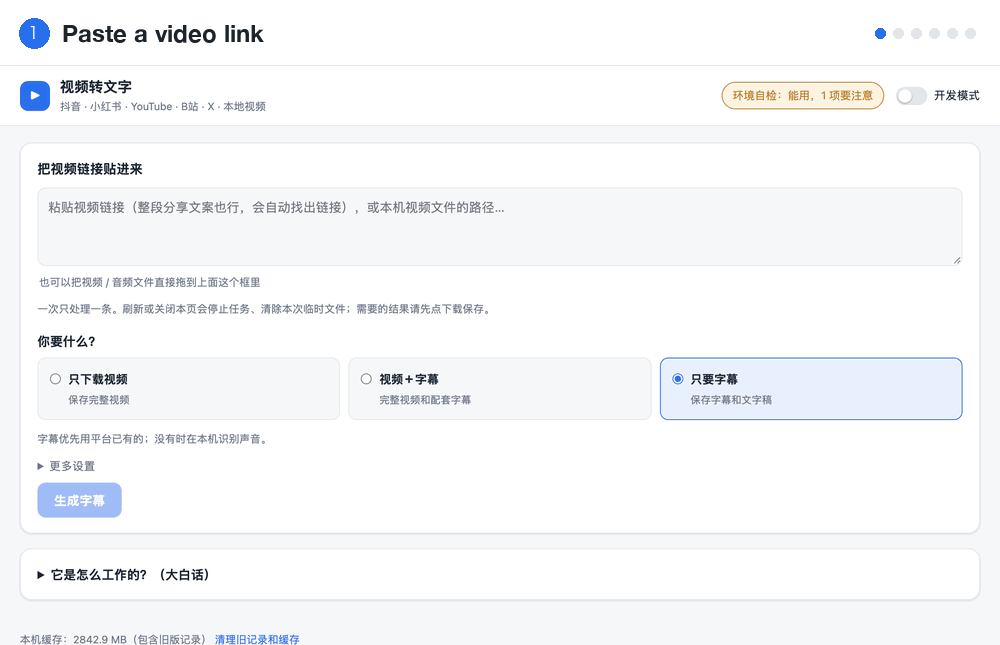
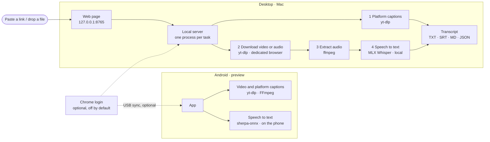

# v2t · Video to Text

[中文](README.md) | **English**

**Paste a video link. Get the video, captions, and a transcript.** No captions? v2t turns the speech into text on your own computer.

Works with Douyin, Xiaohongshu, YouTube, Bilibili, and X (Twitter). Video and audio files on your computer work too.



## Highlights

- **One link is enough**: paste a link, or a whole share message. v2t finds the link.
- **Captions first, transcription when needed**: platform captions are fastest and most accurate. Without them, v2t transcribes locally with Whisper. On an M5 Mac, 20 seconds of speech took about 5 seconds.
- **No login, no upload**: v2t uses public content by default, and speech is recognized only on your computer. For login-only videos, you can turn on a switch to borrow your Chrome login.
- **See every step**: before starting, v2t lists the steps. While running, it shows what it is doing. If something fails, it says why in plain words.
- **Ready to use**: export TXT, SRT, Markdown, or JSON. Drop the SRT straight into a video editor.
- **On your phone too**: an Android preview app downloads videos and transcribes on the phone.

## Three steps

1. Install once (see "Install" below).
2. Double-click **「打开视频转文字.command」** in the project folder.
3. Paste a link → pick what you need → start. Download the results when it finishes.

The app's buttons are in Chinese; the demo above has English captions.

## How it works



- **Desktop**: the web page is only the interface; a local server does the work. Downloads try several methods in order and switch to the next one if a method is blocked.
- **Android**: once installed, downloading and transcription run on the phone. Your Chrome login on the computer can be synced over USB (optional). See the [Android guide](android/README.md) (in Chinese).

## What you need

- A Mac with an **Apple M-series chip** (M1 to M5). Speech-to-text only works on these Macs.
- Other computers (Intel Mac, Windows, Linux) can try downloading videos and platform captions. This is not fully tested, and the app cannot transcribe there. See the [developer notes](docs/DEVELOPMENT.md#without-apple-silicon-or-mlx).
- For phones: the Android preview app. There is no iPhone app.

## Install (once)

Open Terminal on your Mac and run the three blocks below in order. Install [Homebrew](https://brew.sh/) first.

**1. Get the tools and the project**

```bash
brew install uv ffmpeg deno
git clone https://github.com/feihaitun/v2t.git
cd v2t
```

**2. Set up the environment** (the first run downloads quite a lot; let it finish)

```bash
uv python install 3.12
uv venv --python 3.12 .venv
uv pip install --python .venv/bin/python -r requirements.txt
.venv/bin/python -m playwright install chromium
```

> Only want downloads, no speech-to-text (or not on an M-series Mac)? Replace `requirements.txt` with `requirements-base.txt` in the third line.

**3. Check, then open**

```bash
./v2t.sh doctor
./v2t.sh serve
```

Your browser opens [127.0.0.1:8765](http://127.0.0.1:8765/). That is the app. Keep the Terminal window open while you use it; press `Ctrl+C` to quit. Next time, just double-click **「打开视频转文字.command」**.

The first transcription downloads a speech model, so it takes longer.

## Videos that need a login (optional)

v2t works without any account. Some videos or captions are only available when logged in. For those, v2t can borrow the login from Chrome on your computer:

- **YouTube, Bilibili** (Mac only): log in to Chrome, then turn on the 「使用 Chrome 里的 … 登录状态」 (Use Chrome login) switch on the page. It appears after you paste a link from one of these sites. Chrome is never read while it is off. macOS may ask whether to allow access to "Chrome Safe Storage"; click Allow.
- **Douyin**: install the included Chrome extension first:
  1. Go to `chrome://extensions` in Chrome and turn on Developer mode (top right).
  2. Click "Load unpacked" and select the project's `chrome-connector` folder.
  3. Open the app page in the same Chrome, turn on 「使用已登录的 Chrome 获取抖音视频和字幕」 (Use logged-in Chrome for Douyin), and wait for 「Chrome 已连接」 (Chrome connected).
- **X**: public posts only.

Login data (cookies) is used only in memory on your computer, briefly. It is never saved to a file or uploaded. A login only gets what your account can already see.

## FAQ

- **Results gone after refreshing the page?** The page keeps only the current item. Refreshing, closing the page, or starting the next item clears temporary files. Download your results first.
- **Typos in the transcript?** Speech-to-text makes mistakes. The page labels platform captions and v2t's own transcripts separately. Text burned into the video image is not recognized.
- **Download failed?** Run `./v2t.sh doctor` first. Platforms change often, and updating the downloader usually helps: `uv pip install --python .venv/bin/python -U "yt-dlp[default,curl-cffi]"`.
- **Updated the code?** Press `Ctrl+C` to stop the old server, then run `./v2t.sh serve` again. Refreshing the page is not enough.

## Disclaimer

- Only download and use content you have the right to use. Follow copyright law and each platform's terms.
- This project is not affiliated with any of the platforms above.
- Provided as is, with no guarantee that it keeps working. The author is not responsible for how you use it.
- The demo video was generated with text-to-speech; the demo link is yt-dlp's public test video.

## License

[GPL-3.0](LICENSE). Free to use, modify, and share, including commercially. If you distribute a modified version, you must release its full source code under GPL-3.0 as well.

Code structure and libraries: [developer notes](docs/DEVELOPMENT.md).
