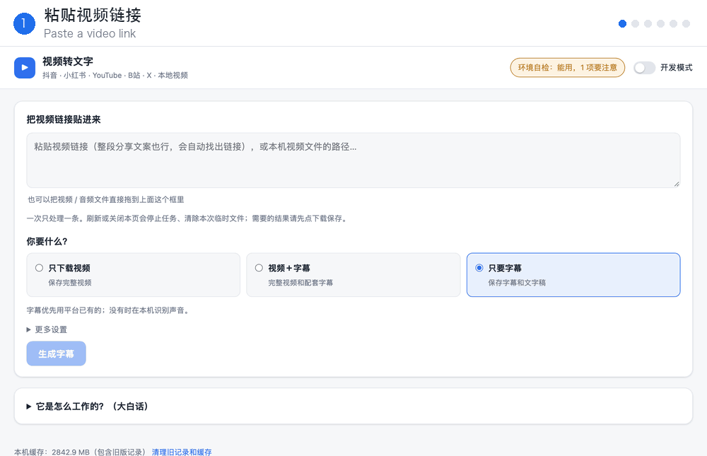
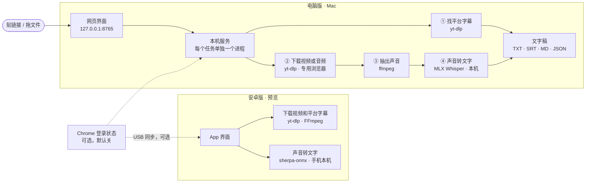

# v2t · 视频转文字

**中文** | [English](README.en.md)

**贴一个视频链接，拿到视频、字幕和文字稿。** 视频没字幕？它就在你自己的电脑上把声音转成文字。

支持抖音、小红书、YouTube、B站、X（Twitter），电脑里的视频、音频文件也能转。



## 亮点

- **一个链接就够**：贴链接，或者直接贴整段分享文案，它自己能找出链接。
- **有字幕拿字幕，没字幕自己转**：优先用平台自带的字幕，最快也最准；没有字幕，就用本机的 Whisper 转文字。在 M5 Mac 上实测，20 秒的语音 5 秒就转完。
- **不登录、不上传**：默认只用公开内容，声音只在你自己的电脑上识别。要登录才能看的视频，可以打开开关，借用 Chrome 里的登录状态。
- **每一步都看得见**：开始前列出要走哪几步，运行时实时显示在做什么；失败了用大白话告诉你原因。
- **拿去就能用**：导出 TXT、SRT、Markdown、JSON，SRT 可以直接拖进剪辑软件。
- **手机也能用**：有安卓预览版，在手机上下载视频、转文字。
- **有英文界面**：页面右上角点「English」就能切成英文，点「中文」切回来。

## 三步上手

1. 安装一次（见下面「安装」）。
2. 双击项目文件夹里的 **「打开视频转文字.command」**。
3. 贴链接 → 选「你要什么」→ 点开始，等它跑完就能下载。

## 它是怎么工作的



- **电脑版**：网页只是界面，真正干活的是本机服务。拿视频会按顺序试几种办法，前一种被拦了就自动换下一种。
- **安卓版**：装好以后，下载和转文字都在手机上完成。电脑上的 Chrome 登录状态可以用 USB 同步过去（可选）。详见[安卓版说明](android/README.md)。

## 你需要什么

- 一台 **Apple M 系列芯片的 Mac**（M1 到 M5 都行）。“声音转文字”这个功能只在这类 Mac 上能用。
- 其他电脑（Intel Mac、Windows、Linux）可以试着下载视频和平台字幕，但没完整测过，页面里也不能转文字。具体见[开发者说明](docs/DEVELOPMENT.md#without-apple-silicon-or-mlx)。
- 想在手机上用：安卓预览版，见[安卓版说明](android/README.md)。没有 iPhone 版。

## 安装（只需一次）

打开 Mac 的「终端」，把下面三段依次复制进去运行。开始前要先装好 [Homebrew](https://brew.sh/)。

**1. 下载工具和项目**

```bash
brew install uv ffmpeg deno
git clone https://github.com/feihaitun/v2t.git
cd v2t
```

**2. 安装运行环境**（第一次要下载不少东西，等它跑完）

```bash
uv python install 3.12
uv venv --python 3.12 .venv
uv pip install --python .venv/bin/python -r requirements.txt
.venv/bin/python -m playwright install chromium
```

> 只想下载、不要转文字（或者不是 M 系列 Mac）：把第三行的 `requirements.txt` 换成 `requirements-base.txt`。

**3. 检查一下，然后打开**

```bash
./v2t.sh doctor
./v2t.sh serve
```

浏览器会打开 [127.0.0.1:8765](http://127.0.0.1:8765/)，这就是使用页面。用的时候终端窗口别关，按 `Ctrl+C` 退出。以后双击 **「打开视频转文字.command」** 就能打开。

第一次转文字时，会先下载语音识别模型，要多等一会儿。

## 要登录才能看的视频（可选）

不登录也能用。有些视频或字幕要登录才拿得到，这时可以借用你电脑上 Chrome 的登录状态：

- **YouTube、B站**（只支持 Mac）：先在 Chrome 里登录，再打开页面上的「使用 Chrome 里的 YouTube / B站 登录状态」开关（贴了这两个网站的链接才会出现）。不打开就不会读。Mac 可能弹窗问你是否允许读取「Chrome 安全存储」，点允许即可。
- **抖音**：要先装一个配套的 Chrome 扩展：
  1. Chrome 地址栏输入 `chrome://extensions`，打开右上角「开发者模式」。
  2. 点「加载已解压的扩展程序」，选项目里的 `chrome-connector` 文件夹。
  3. 在同一个 Chrome 里打开使用页面，打开「使用已登录的 Chrome 获取抖音视频和字幕」，看到「Chrome 已连接」就能用了。
- **X**：只支持公开帖子。

登录信息（Cookie）只在你电脑的内存里临时用一下，不会存成文件、不会上传。登录只能拿到你账号本来就能看的内容。

## 常见问题

- **页面刷新后结果没了？** 页面只保留当前这一条。刷新、关闭页面或开始下一条，临时文件就会被清掉。跑完请先下载保存。
- **转出来的文字有错字？** 声音转文字难免出错。平台自带的字幕和自己转的文字，页面上会分开标明。画面上印着的字目前识别不了。
- **下载失败？** 先运行 `./v2t.sh doctor` 看看提示。平台经常改规则，更新一下下载组件常常就好了：`uv pip install --python .venv/bin/python -U "yt-dlp[default,curl-cffi]"`。
- **更新了项目代码？** 先按 `Ctrl+C` 关掉旧的，再运行 `./v2t.sh serve`。只刷新网页不够。

## 版本

当前版本：**v0.3.0**（2026-11-20）。每一版更新了什么，看[发布页](https://github.com/feihaitun/v2t/releases)。

| 部分 | 版本 |
|---|---|
| 电脑版（网页） | 0.3.0 |
| 安卓版 | 0.1.0 预览 |
| Chrome 扩展（抖音用） | 0.2.0-rc.1 |

- 最新代码都在 `main` 分支，`git clone` 下来的就是最新版。
- 已经装过、想更新：在项目文件夹里运行 `git pull`，再重新打开（见上面「常见问题」）。
- 想用旧版本：在发布页或 Tags（标签）里找到那一版，下载它的源码。

## 声明

- 请只下载、使用你有权使用的内容，遵守版权法和各平台的用户协议。
- 本项目和上面提到的任何平台都没有关系。
- 本项目按现状提供，不保证一直能用，作者不对使用后果负责。
- 演示图里的视频是用电脑朗读生成的，演示链接是 yt-dlp 的公开测试视频。

## 许可协议

[GPL-3.0](LICENSE)。可以免费使用、修改、转发，也可以商用。但只要你把改过的版本发布出去，就必须同样用 GPL-3.0 公开全部源码。

想看代码结构和用到的库：[开发者说明](docs/DEVELOPMENT.md)。
